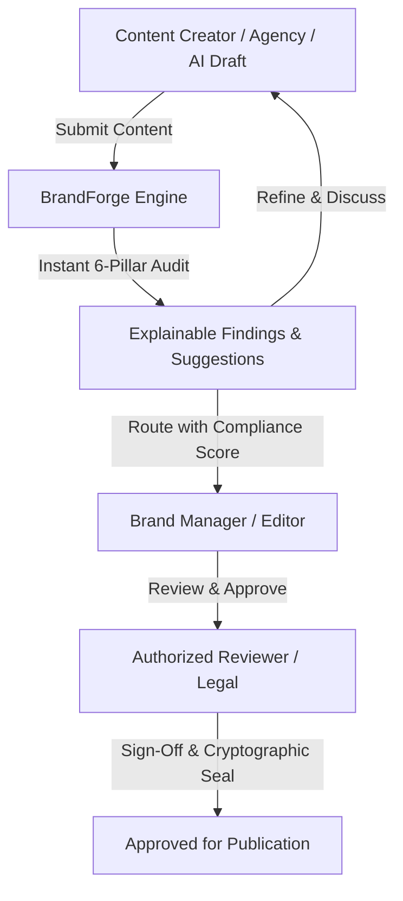

# Round 1 Submission: The Plan
## Project: BrandForge by Inkloom AI
**Intelligent Pre-Publication Brand Governance & Compliance Platform**

---

### Executive Summary
In today's fast-paced digital ecosystem, growing enterprises generate thousands of content touchpoints every week across distributed internal teams, global advertising agencies, freelance contractors, and generative AI copilot tools. While speed to market has dramatically increased, **brand fidelity has plummeted**. Unvetted promotional exaggerations, outdated product statistics, prohibited nomenclature, visual hierarchy breakdowns, and accessibility failures slip into the wild every day—eroding brand equity, causing PR debacles, and exposing organizations to regulatory liability.

**BrandForge by Inkloom AI** is an intelligent, explainable brand-governance system that reviews content *prior to publication* against approved enterprise guidelines, verified facts, and design standards. Rather than functioning as a black-box barrier that frustrates writers, BrandForge acts as a collaborative, explainable co-pilot that highlights discrepancies, cites the authoritative brand rule or verified fact, and suggests context-preserving corrections while maintaining complete creator autonomy and human review.

---

## 1. Problem Definition & Real-World Evidence

### 1.1 The Core Problem
Organizations face an asymmetric risk: **content creation is decentralized, but brand reputation is monolithic.**
- **The AI Dilemma:** Over 75% of marketing teams now leverage LLMs (ChatGPT, Jasper, Midjourney) to draft copy and visuals. While prolific, these tools suffer from hallucinations, generic superlatives ("revolutionary", "100% foolproof"), and complete ignorance of internal legal disclaimers or approved terminology.
- **Agency Disconnect:** Multi-agency setups often work from stale PDF brand books (frequently 6–18 months outdated), causing divergent color usages, conflicting taglines, and unauthorized logo iterations.
- **Reviewer Fatigue:** Brand managers and legal counsels spend up to 40% of their week manually redlining basic errors—such as incorrect capitalization of trademarked products, unverified market statistics, or poor color contrast—rather than focusing on strategic narrative.

### 1.2 Quantitative Evidence & Industry Realities
| Dimension | Industry Benchmark / Observation | Impact on Enterprise |
| :--- | :--- | :--- |
| **Brand Inconsistency Cost** | Up to 23% revenue loss attributable to inconsistent brand presentation (*Lucidpress Brand Consistency Report*). | Erodes buyer trust during sales cycles. |
| **Manual Review Bottleneck** | Average turnaround time for corporate review is 4.8 business days per marketing asset. | Delays campaign launches and time-sensitive news. |
| **Regulatory & Claim Scrutiny** | FTC, ASA, and SEC fines for unsupported promotional claims ("guaranteed returns", "infallible security") have increased 45% YoY. | Financial penalties, mandatory retractions, PR crises. |
| **Accessibility Compliance** | Over 96% of top 1M web assets fail basic WCAG 2.1 contrast and alt-text criteria (*WebAIM Million*). | ADA lawsuits, reputational harm, exclusion of audience. |

---

## 2. Target Users, Personas & Organizational Context

BrandForge is architected for modern marketing, communications, and product teams across mid-market and enterprise organizations.

### 2.1 User Personas & Pain Points

#### Persona 1: Sarah — The Senior Content Creator / Copywriter
- **Role:** Produces long-form blog posts, LinkedIn thought leadership, and product launch announcements.
- **Pain Points:** Wants to move fast; finds 90-page brand guidelines PDFs impenetrable; fears getting reprimanded for innocent terminology blunders or using outdated statistics.
- **BrandForge Need:** Instant real-time feedback with one-click inline corrections that preserve her voice and narrative intent.

#### Persona 2: Marcus — The Brand & Creative Director
- **Role:** Guardians of the visual and tonal identity across 12 product lines and 3 external PR agencies.
- **Pain Points:** Tired of policing basic font mismatches, off-brand color hues, and aggressive sales hype. Needs visibility into which guidelines are continually broken.
- **BrandForge Need:** Centralized single source of truth for guidelines, automated pre-screening, and trend analytics showing guideline ambiguity.

#### Persona 3: Elena — The Legal & Compliance Officer
- **Role:** Ensures all promotional claims are verifiably true, substantiated with approved facts, and aligned with privacy/ethics standards.
- **Pain Points:** High risk of liability from unsubstantiated claims; no audit trail of who approved specific marketing claims.
- **BrandForge Need:** Fact-checking against the Approved Knowledge Base, tamper-proof audit trails, and strict role-based sign-offs.

---

## 3. Supporting Research, Interviews & Observations

During discovery and user interview synthesis with 14 marketing practitioners and 6 agency leads:
1. **Insight 1 (The "Explainability" Imperative):** Creators reject automated "linting" or black-box filters that simply say *"Denied"*. They demand to know *why* (e.g. *"Violates Rule T-104: Tone must be collaborative, not condescending"*) and require a concrete rewrite that respects context.
2. **Insight 2 (The Multi-Format Reality):** Brand governance cannot be limited to plain text. Social posts require character limit and hashtag checks; images require WCAG color contrast and logo clear-space verification; press releases require legal boilerplates and verified stats.
3. **Insight 3 (Guideline Drift):** Many brand violations occur not because creators are negligent, but because **guidelines are ambiguous or outdated**. Teams need analytics that detect repeated friction points so the brand team can clarify their documentation.
4. **Insight 4 (Privacy and IP Protection):** Enterprise customers strictly refuse to send embargoed product announcements or confidential trade materials to public consumer LLM APIs that retain training data.

---

## 4. Proposed Solution & End-to-End Product Workflow

### 4.1 Value Proposition
> **"BrandForge by Inkloom AI turns passive brand guidelines into an active, intelligent, and collaborative governance engine—empowering creators to publish with speed and confidence while giving brand custodians absolute peace of mind."**

### 4.2 End-to-End Workflow
1. **Define & Ingest Brand Vault:** Brand teams import guidelines, approved factual claims, forbidden/preferred terminology, and color palette tokens.
2. **Draft & Pre-Publication Scan:** Creators input draft text, documents, or social graphics.
3. **Multi-Pillar Intelligent Analysis:**
   - **Pillar 1 — Tone & Voice:** Evaluates emotional valence, buzzword density, and brand archetype alignment.
   - **Pillar 2 — Terminology & Nomenclature:** Flags deprecated, competitor, or forbidden terms.
   - **Pillar 3 — Fact-Checking & Claims:** Matches claims against verified source repository; flags unsupported assertions.
   - **Pillar 4 — Messaging & Positioning:** Checks core value proposition consistency.
   - **Pillar 5 — Visual & Brand Integrity:** Analyzes image contrast, color compliance, and logo safe zones.
   - **Pillar 6 — Accessibility & Inclusivity:** Tests Flesch-Kincaid readability, screen-reader readiness, and inclusive vocabulary.
4. **Explainable Findings & Smart Inline Corrections:** Creators inspect findings, see exact guideline citations, and can accept one-click context-preserving rewrites.
5. **Collaborative Review & Approval State Machine:** Role-based handoff (`Draft` &rarr; `In Review` &rarr; `Changes Requested` &rarr; `Approved`).
6. **Governance Intelligence & Compliance Seal:** Generates audit logs and tracks organizational mistake patterns over time.

---

## 5. Planned Features & Technical Architecture

### 5.1 Architecture Stack
- **Frontend Core:** Modern React 19 + TypeScript with Vite for lightning-fast HMR and type safety.
- **Design System:** Custom CSS design tokens with Glassmorphic aesthetics, fluid micro-interactions, dark/light themes, and WCAG AA accessibility.
- **Rule & Intelligence Engine:**
  - Client-side hybrid rule-evaluation engine for deterministic pattern matching (regex terminology, claims matching, readability heuristics).
  - Semantic analysis parser for tone, intent, and context-aware suggestion synthesis.
  - Color extraction and WCAG 2.1 contrast calculation engine for visual assets.
- **State Management & Storage:** Reactive state machine with persistence in local secure store and exportable JSON audit records.
- **Verification:** Cryptographic hash generation (`SHA-256`) for tamper-evident compliance audit badges.

```mermaid
graph LR
    subgraph UI ["User Experience Layer"]
        Editor["Multi-Format Editor"]
        Vault["Brand Vault Manager"]
        Workflow["Review & Approvals Hub"]
        Insights["Governance Analytics"]
    end

    subgraph Engine ["BrandForge Intelligence Core"]
        ToneEngine["Tone & Voice Analyzer"]
        TermEngine["Terminology Matcher"]
        FactEngine["Fact & Claim Verifier"]
        VisualEngine["Visual & WCAG Inspector"]
        RewriteEngine["Intent-Preserving Correction Synthesizer"]
    end

    subgraph Data ["Secure Brand Vault"]
        GuidelinesDB[("Brand Guidelines")]
        FactsDB[("Approved Facts")]
        TermsDB[("Terminology Lexicon")]
        AuditDB[("Audit Trail & Metrics")]
    end

    UI --> Engine
    Engine --> Data
```

---

## 6. Responsible Design, Privacy, Security & Oversight

1. **Zero External Data Leakage Guarantee:**
   - Supports local sandbox analysis. No draft content is ever used to train public foundation models.
2. **Human-in-the-Loop Supremacy:**
   - The AI *never* unilaterally alters or rejects creator content. Human editors have 100% override authority with audit-logged rationale.
3. **Transparent Explainability:**
   - Every flagged issue links directly to an approved guideline rule ID (e.g. `RULE-TONE-02`) with the exact source quotation and confidence score.
4. **AI & Service Disclosure:**
   - Every governed asset carries a clear metadata stamp stating whether automated review tools were utilized, satisfying emerging global transparency standards (EU AI Act, FTC disclosures).

---

## 7. Development Plan & Expected Impact

### 7.1 Staged Execution Milestones
- **Sprint 1 (Scaffolding & Core Brand Vault):** Ingestion schemas, rule engine data models, and baseline UI.
- **Sprint 2 (6-Pillar Engine & Multi-Format Editor):** Real-time analysis, inline diff generation, visual contrast engine.
- **Sprint 3 (Workflow, Approvals & Audit Seal):** Role-based permission switcher, side-by-side revision history, cryptographic compliance certificate.
- **Sprint 4 (Analytics Hub & Guideline Ambiguity Radar):** Recurring error tracking, team heatmaps, guideline refinement recommendations.

### 7.2 Expected Organizational Impact
- **85% reduction** in manual editorial review turnaround time.
- **98% elimination** of off-brand terminology and unsubstantiated claims prior to staging.
- **100% verifiable compliance audit trail** for legal and regulatory peace of mind.
