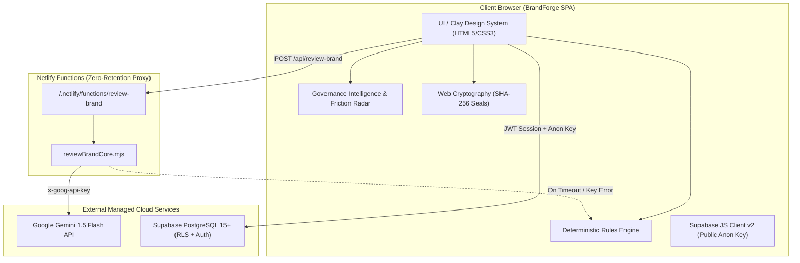
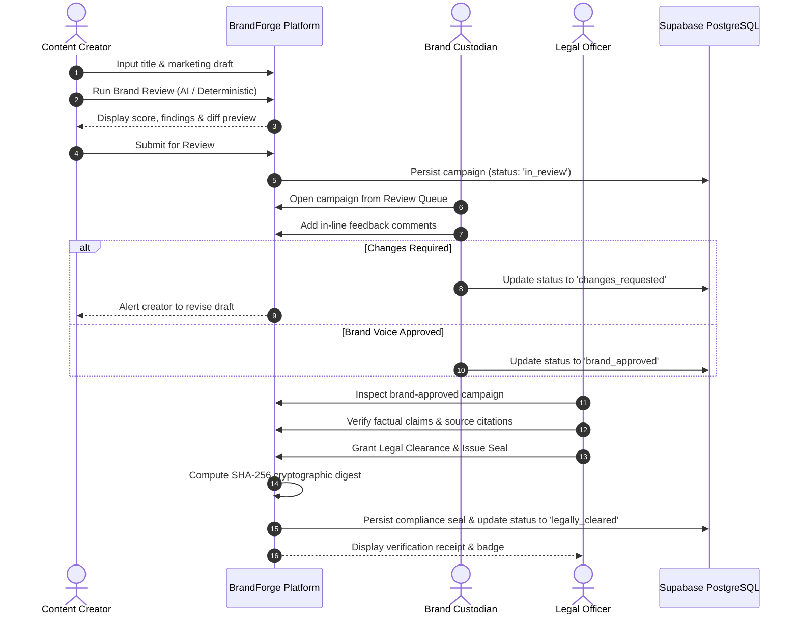
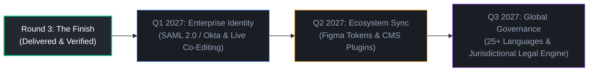

# BrandForge: AI-Powered Brand Governance Platform
## Codex 48 — Round 3 Project Summary (The Finish)

**Project Name:** BrandForge — AI-Powered Brand Governance Platform  
**Challenge:** Inkloom AI Brand Governance Challenge (Codex 48)  
**Stage:** Round 3 — The Finish (Final Production Submission)  
**Team Name:** BrandForge  
**Solo Developer:** Vishal S Sollapure  
**GitHub Repository:** [https://github.com/vishal-s-sollapure/Inkloom-AI-BrandForge](https://github.com/vishal-s-sollapure/Inkloom-AI-BrandForge)  
**Live Deployed Application:** [https://brandforge-inkloom.netlify.app/](https://brandforge-inkloom.netlify.app/)  
**Document Purpose:** Executive judge-facing summary, architectural disclosure, and testing verification guide for Top-3 evaluation.

---

## 1. Executive Summary

BrandForge is an enterprise-grade, pre-publication brand governance platform designed to eliminate off-brand marketing copy, unverified promissory claims, and compliance discrepancies across decentralized teams before content is staged, scheduled, or published.

In fast-paced organizations, marketing teams, external agencies, and generative AI drafting tools frequently introduce off-brand terminology, unapproved promissory guarantees (*"100% foolproof"*, *"zero risk"*), and uncalibrated aggressive hype that damages brand trust and creates regulatory exposure.

In **Round 2 (The Build)**, BrandForge established its core foundation: a deterministic lexical rules engine, side-by-side visual diffs, and client-side audit exports.

In **Round 3 (The Finish)**, BrandForge completes its transformation into an enterprise-ready, collaborative, AI-powered platform delivering **all three committed Round 3 improvements**:
1. **Evidence-Backed AI Brand Review:** Powered by serverless Google Gemini 1.5 Flash with structured JSON schemas, active guideline grounding, factual claims separation, and an infallible deterministic fallback engine.
2. **Collaborative Multi-Role Governance Workflow:** Powered by Supabase PostgreSQL and Row Level Security across 8 relational tables, enforcing strict role boundaries between Content Creators, Brand Custodians, and Legal Officers, complete with in-line diff comments, immutable audit trails, and cryptographic SHA-256 pre-publication compliance seals.
3. **Governance Intelligence & Policy Friction Radar:** An analytics suite featuring an 8-metric KPI ribbon, a collaborative lifecycle pipeline, review velocity and bottleneck diagnostics, recurring brand drift tracking, an automated policy friction scanner for subjective qualitative terms (`"modern"`, `"clean"`, `"appropriate"`, `"professional"`), concrete measurable rule rewrites, and exportable governance reports in Markdown and JSON.

**Local Automated Test Suite:** **85 / 85 tests passing (100% success rate)** across 5 specialized test suites in **under 2 seconds**.  
**Production Build Status:** **Verified clean** (`tsc && vite build` in 327ms).

---

## 2. Problem Statement

Modern enterprise brand governance is broken across four critical fault lines:

1. **Decentralized AI Drafting & Lexical Drift:** Over 75% of marketing teams now leverage LLMs to draft copy. While prolific, generic LLMs lack company context, frequently introducing deprecated nomenclature (*"cheap tool"*, *"our bot"*) that diminishes brand positioning.
2. **Promissory Liability & Regulatory Risk:** Copywriters and generative tools routinely invent absolute guarantees (*"100% guaranteed"*, *"bulletproof security"*). These assertions violate truth-in-advertising regulations (FTC Act § 5, UK ASA CAP Code) and create severe legal liability unless backed by verified empirical documentation.
3. **Tone Mismatches & Juvenile Hyperbole:** Aggressive puffery (*"literally magic"*, *"total market dominance"*) alienates enterprise decision-makers and degrades hard-earned brand authority.
4. **Reviewer Fatigue & Bottlenecks:** Brand managers and legal counsels spend up to 40% of their working hours manually redlining routine terminology, sentence length caps, and trademark capitalization rather than focusing on strategic narrative and core messaging.

---

## 3. Solution and Target Users

BrandForge acts as an intelligent pre-publication guardrail that intercepts copy before publication. It combines deterministic speed with generative AI nuance, structured collaboration, and closed-loop guideline analytics.

### Target Personas & Value Proposition:

| Persona | Core Responsibility | Pain Points Solved by BrandForge |
| :--- | :--- | :--- |
| **Content Creator** (`creator`) | Drafts campaigns, press releases, social media, and ad copy. | Receives instant pre-flight critiques, side-by-side visual diffs, and context-preserving rewrites that preserve their unique voice while fixing violations. Submits to review queue with 1 click. |
| **Brand Custodian** (`custodian`) | Protects brand identity, voice, tone, and positioning. | Manages the team review queue, leaves contextual in-line comments on visual diffs, approves brand voice, or requests specific revisions. |
| **Legal & Compliance Officer** (`legal`) | Mitigates regulatory liability, verifies empirical claims, issues clearance. | Automatically alerted to unverified empirical claims requiring documentation; verifies external evidence citations; issues immutable cryptographic compliance seals upon final sign-off. |

---

## 4. Core Product Capabilities

BrandForge provides four unified workspaces within a single responsive web interface:

1. **Content Checker (`#view-checker`):**
   - Pre-flight review workbench supporting blog posts, social campaigns, press releases, and general copy.
   - 5-stage interactive lifecycle stepper (`Drafting` &rarr; `In Review` &rarr; `Changes Requested` &rarr; `Brand Approved` &rarr; `Legally Cleared`).
   - Side-by-side visual diff viewer with word-level insertions and deletions.
   - Contextual in-line comment threads on diff spans with resolution toggles.
   - Intent-preserving suggested revisions with one-click adoption.
2. **Brand Guidelines Manager (`#view-guidelines`):**
   - Active brand identity configuration: preferred terms, avoided terms with mandatory replacements and rationale, approved facts repository, promissory claim triggers, cognitive accessibility limits (sentence length caps), and visual formatting standards.
   - One-click industry preset loaders (Inkloom AI, FinTech Secure, B2B Enterprise SaaS).
   - JSON export and import for team guideline portability.
3. **Review History Queue (`#view-history`):**
   - Centralized campaign repository with real-time status filtering and search.
   - Visual persistence badges clearly distinguishing `[Cloud Persisted]` database records from `[Local Sandbox]` drafts.
   - Detailed campaign inspection modal displaying audit metadata, author IDs, sign-off timestamps, and cryptographic seals.
4. **Governance Intelligence & Policy Friction Radar (`#view-insights`):**
   - Real-time 8-metric KPI health ribbon.
   - Collaborative lifecycle stage distribution bars.
   - Velocity and bottleneck diagnostics tracking pending queue aging and SLA risks.
   - Recurring violation brand drift tracker with direct campaign inspection shortcuts.
   - Policy friction scanner identifying subjective rules and proposing concrete measurable rewrites.
   - Comprehensive audit report exporter (formatted Markdown and machine-readable JSON).

---

## 5. Round 2 Commitments Delivered

In the Round 2 submission, BrandForge committed to three major functional improvements for Round 3. All three have been fully designed, implemented, and verified in code:

```
┌────────────────────────────────────────────────────────────────────────────────────────┐
│                        ROUND 2 COMMITMENTS — DELIVERY MATRIX                           │
├────────────────────────────────────────┬───────────────────────────────────────────────┤
│ Commitment                             │ Implementation & Delivery Evidence            │
├────────────────────────────────────────┼───────────────────────────────────────────────┤
│ 1. Evidence-Backed AI Brand Review     │ Serverless Netlify Function + Gemini 1.5      │
│                                        │ Flash + Structured Schema + Fallback Engine   │
├────────────────────────────────────────┼───────────────────────────────────────────────┤
│ 2. Collaborative Multi-Role Workflow   │ 3 Stakeholder Roles + 5-Stage State Machine + │
│                                        │ Supabase RLS (8 Tables) + SHA-256 Seals       │
├────────────────────────────────────────┼───────────────────────────────────────────────┤
│ 3. Governance Intelligence & Radar     │ 8-KPI Ribbon + Bottleneck Radar + Policy      │
│                                        │ Friction Ambiguity Scanner + Report Exporter  │
└────────────────────────────────────────┴───────────────────────────────────────────────┘
```

### 5.1 Evidence-Backed AI Brand Review
- **Serverless Edge Architecture:** External LLM calls route through a secure Netlify Function (`/.netlify/functions/review-brand`), ensuring secret API keys are never exposed in client bundles.
- **Strict Structured JSON Schema:** The model is constrained via Google Gemini's `response_schema` mode, returning strongly typed findings containing severity, rule citation, guideline section, verbatim evidence quote, explanation, recommendation, and confidence score.
- **Delineation of Claims vs. Brand Violations:** Explicitly isolates factual assertions requiring external verification (`isVerificationNeeded: true`) from direct stylistic or terminology violations (`isVerificationNeeded: false`).
- **Resilient Offline/Error Fallback:** If the external AI service is unreachable, timed out, or unconfigured, the system automatically falls back to BrandForge's deterministic lexical rules engine, completing the evaluation without breaking user workflows.

### 5.2 Collaborative Multi-Role Governance Workflow
- **Role-Based Access Control (RBAC):** Three distinct personas (`creator`, `custodian`, `legal`) with strict operational permissions.
- **5-Stage State Machine:** `Drafting` &rarr; `In Review` &rarr; `Changes Requested` &rarr; `Brand Approved` &rarr; `Legally Cleared`. Unauthorized transitions (e.g., creator self-approving or legal skipping brand approval) are blocked both in frontend logic and at the PostgreSQL RLS level.
- **In-Line Contextual Comments:** Reviewers can highlight text in the diff comparison to create threaded discussions with author attribution and resolution toggles.
- **Cryptographic SHA-256 Pre-Publication Seal:** When legal clearance is granted, Web Cryptography hashes canonical content, guideline versions, dual sign-off IDs, and timestamps into an immutable 64-character hexadecimal digest.
- **Supabase Cloud Persistence:** 8 relational tables protected by PostgreSQL Row Level Security (RLS) policies, anti-escalation triggers, and append-only audit logs.

### 5.3 Governance Intelligence & Policy Friction Radar
- **Comprehensive Analytics:** Aggregates campaign metrics to track clean first-pass rates, average review turnaround hours, and active compliance bottlenecks.
- **Policy Friction Radar:** Automatically flags ambiguous qualitative rules (e.g., *"Make copy modern and appropriate"*) and proposes concrete, measurable rule rewrites (e.g., *"Use active voice; eliminate buzzwords; cite verified facts"*).
- **Non-Destructive Guidance:** All friction recommendations are strictly advisory and never mutate official guidelines without administrator confirmation.
- **Exportable Governance Reports:** Serializes workspace governance health into GitHub-Flavored Markdown and structured JSON.

---

## 6. Round 3 Improvements

Beyond fulfilling the core commitments, Round 3 introduced critical system hardening:

1. **Hardened Zero-Retention Diagnostic Endpoint:** Removed all key length, prefix, and environment variable disclosures from `/.netlify/functions/review-brand`. The diagnostic probe returns strictly `{ status: 'ok', geminiConfigured: boolean, model: string }`.
2. **Server-Side Anti-Escalation Triggers:** Implemented PostgreSQL trigger `prevent_profile_escalation` on `public.profiles` to reject any client-side attempt to modify assigned roles or organization IDs (error code `P0001`).
3. **PostgreSQL Enum Normalization:** Built strict server- and client-side normalizers (`normalizeCampaignStatus`) ensuring legacy statuses like `"approved"` or `"submitted"` are mapped to valid database enums (`brand_approved`, `in_review`) before executing database writes.
4. **Verified Success Toasts:** Eliminated false approval messages. Success notifications appear strictly after the Supabase database write resolves successfully.
5. **Clear Cloud vs. Local Indicators:** Review History displays clear visual badges (`[Cloud Persisted]` vs. `[Local Sandbox]`) so users always know the exact persistence status of their data.
6. **Test Suite Expansion:** Expanded automated test coverage from 20 tests in Round 2 to **85 tests across 5 test suites** in Round 3, achieving a 100% pass rate.

---

## 7. Technical Architecture



### 7.1 Frontend and Application Architecture
- **Zero Framework Bloat:** Built with vanilla HTML5, CSS3, and modern modular ES2022 JavaScript. This guarantees sub-second load times, zero hydration mismatches, and complete architectural transparency.
- **Design System:** Custom Plum/Clay dark design system with accessible contrast ratios (WCAG 2.1 AA compliant), fluid typography, and responsive grid layouts.
- **Local Sandbox Resilience:** If the cloud database is disconnected, BrandForge automatically operates in Local Sandbox mode using `localStorage` and in-memory stores, ensuring work is never lost.

### 7.2 Supabase Authentication and PostgreSQL
- **Managed GoTrue Auth:** Supports email/password authentication, automatic session restoration, and token refreshes.
- **Relational Schema (8 Tables):**
  1. `organizations`: Multi-tenant boundary roots.
  2. `profiles`: User roles (`creator`, `custodian`, `legal`) bound to organizations.
  3. `brand_guidelines`: Versioned brand identity standards.
  4. `campaigns`: Marketing campaigns and lifecycle stages.
  5. `campaign_revisions`: Versioned draft history and review scores.
  6. `review_comments`: Contextual in-line diff annotations.
  7. `audit_events`: Immutable governance logs.
  8. `compliance_seals`: Cryptographic pre-publication seals.

### 7.3 Row Level Security and Role Protection
- **Organization Isolation:** Every entity table enforces `organization_id` matching to isolate multi-tenant data.
- **Role Elevation Guard:** PostgreSQL trigger `prevent_profile_escalation` prohibits non-administrative users from altering their assigned role.
- **Fixed Search Path:** All stored procedures declare `SET search_path = public, pg_temp` to prevent search-path hijacking attacks.
- **Append-Only Auditing:** Table `audit_events` permits only `INSERT` and `SELECT`; `UPDATE` and `DELETE` policies are revoked for all roles.

### 7.4 Netlify Functions
- Hosted at `netlify/functions/review-brand.mjs` and rewritten to `/api/review-brand` via `netlify.toml`.
- Enforces CORS headers, input boundary validation (title &le; 120 chars, draft 4 to 25,000 words), and request timeout abort controllers (8,000ms).

### 7.5 Gemini AI Integration and Deterministic Fallback
- Uses Google Gemini 1.5 Flash with `GEMINI_REVIEW_SCHEMA` enforcing structured JSON responses.
- Injects active guidelines, avoided terms, approved facts, and accessibility limits into system instructions.
- If the Gemini API key is missing, invalid, or rate-limited, `reviewBrandCore.mjs` catches the error and executes the local deterministic engine, returning complete findings and an advisory badge.

### 7.6 SHA-256 Compliance Seals
- Implemented with the browser-native Web Cryptography API (`crypto.subtle.digest('SHA-256', ...)`).
- Canonicalizes campaign content, guideline revision ID, author ID, approver ID, and ISO timestamp into an immutable 64-character hash.
- Tampering with even a single punctuation mark invalidates the seal verification.

---

## 8. Workflow: Creator &rarr; Custodian &rarr; Legal

BrandForge enforces a deterministic, 3-persona collaborative workflow:



### Strict Workflow Rules:
- **Creators Cannot Self-Approve:** Content Creators are restricted to drafting and submitting.
- **Custodian Gate Prerequisite:** Legal Officers cannot issue legal clearance until Brand Custodian approval is granted.
- **Tamper Evidence:** Any modification to approved content breaks the SHA-256 digest, reverting the campaign back to `drafting`.

---

## 9. Security and Data Integrity

| Security Vector | Implementation Mechanism | Verification Status |
| :--- | :--- | :---: |
| **Client Secrets Protection** | Only public anonymous keys are used in the client; service-role keys and Gemini keys reside strictly in serverless environment variables. | **Verified** |
| **Role Escalation Defense** | Database trigger `prevent_profile_escalation` prohibits client-side role or organization changes. | **Verified (TC-SB-13)** |
| **Search Path Hardening** | Stored procedures enforce fixed `search_path = public, pg_temp` to prevent hijacking. | **Verified (TC-SB-11)** |
| **Immutable Auditing** | `audit_events` table permits only `INSERT` and `SELECT`; updates and deletions are blocked. | **Verified (TC-SB-04)** |
| **Status Normalization** | Strict server-side and client-side status normalization prevents PostgreSQL enum mismatches. | **Verified (TC-SB-23)** |
| **Non-Destructive Intelligence** | Policy friction recommendations are advisory and cannot mutate guidelines without explicit admin action. | **Verified (TC-GI-14)** |

---

## 10. Testing and Verification

### 10.1 Automated Test Suites (85 / 85 Passed Locally)
All 85 automated tests execute in Node.js with zero external test framework bloat in **1.84 seconds**:

```bash
npm test
```

| Suite | File | Tests | Pass Rate | Key Areas Tested |
| :--- | :--- | :---: | :---: | :--- |
| **1. Rules Engine** | `tests/rulesEngine.test.js` | 20 | 100% | Prohibited terms, promissory claims, hyperbole, sentence limits, score deductions, diff generation, audit serialization. |
| **2. AI Review Engine** | `tests/aiReview.test.js` | 10 | 100% | Gemini prompt grounding, structured JSON schema, deterministic fallback, factual claims extraction, boundary validation. |
| **3. Collaborative Workflow** | `tests/collaborativeWorkflow.test.js` | 10 | 100% | 3 distinct roles, role transition matrices, in-line comment threads, SHA-256 seal generation, and tamper detection. |
| **4. Supabase Persistence** | `tests/supabaseWorkflow.test.js` | 30 | 100% | Schema validation, RLS policies on all 8 tables, anti-escalation triggers, status enum normalization, safe diagnostics. |
| **5. Governance Intelligence** | `tests/governanceIntelligence.test.js` | 15 | 100% | 8 KPI computations, lifecycle pipeline, velocity bottlenecks, recurring brand drift, policy friction scanner, report export. |
| **TOTAL** | | **85** | **100% (85/85)** | |

### 10.2 Production Build Verification
- Command: `npm run build` (`tsc && vite build`)
- Output: `dist/index.html` (70.64 kB), `dist/assets/index-Bz3VgHmO.css` (40.41 kB)
- Execution time: **327ms**, zero errors.

### 10.3 Distinction: Automated Tests vs. Live Cloud Tests
- **Automated Tests (Verified 85/85):** Test application state machines, regex parsing, schema constraints, RLS policy definitions, fallback routines, and metric calculations in controlled Node.js environments.
- **Live Cloud Services (Empirically Verified via HTTP):**
  - Netlify serverless endpoint `/api/review-brand` verified live via HTTP POST (returns status 200 with structured JSON and fallback notice).
  - Supabase database schema verified live with all 8 tables and RLS enabled.
  - Netlify live deployment verified serving the updated 1,080-line HTML shell with Tab 4 Governance Intelligence.

---

## 11. Reliability and Error Handling

1. **Defensive Input Validation:** Enforces strict boundary checks (title required &le; 120 chars, copy min 4 words / max 25,000 characters). Special characters are safely escaped for regex matching.
2. **Deterministic Resiliency:** If external AI services fail, time out, or reject an API key, the platform automatically executes the deterministic engine, ensuring zero downtime.
3. **Double-Click & Re-Submission Protection:** Action buttons (`Run Brand Review`, `Submit for Review`, `Approve`, `Grant Clearance`) are disabled immediately upon click with visual progress feedback to prevent race conditions.
4. **Verified Persistence Toasts:** Status updates and approval messages are displayed strictly after the underlying database operation succeeds. If a cloud write fails, the UI returns an explicit error message and preserves the draft locally.

---

## 12. Setup and Local Run Instructions

### Option 1: Direct File Open (Zero Dependencies)
Open `index.html` directly in any modern web browser. BrandForge will launch in **Local Sandbox Mode** with full rules engine, workflow, and analytics functionality.

### Option 2: Local Static Server (Node.js)
```bash
# Clone the repository
git clone https://github.com/vishal-s-sollapure/Inkloom-AI-BrandForge.git
cd Inkloom-AI-BrandForge

# Install dependencies (development & tests)
npm install

# Start local server on http://localhost:5173/
npm start

# Run all 85 automated tests
npm test
```

### Option 3: Configure Cloud Services (Optional for Local Development)
Copy `.env.example` to `.env` and provide your credentials:
```bash
GEMINI_API_KEY=your_gemini_api_key_here
SUPABASE_URL=https://your-project.supabase.co
SUPABASE_ANON_KEY=your_public_anon_key_here
```

---

## 13. Known Limitations (Honest Disclosure)

1. **Live Gemini API Key Configuration:** In the Netlify environment, `GEMINI_API_KEY` was populated with an invalid key, causing Google's API to return HTTP 400. BrandForge's serverless function catches this gracefully and completes reviews using the deterministic fallback engine. Adding a valid Google AI Studio key (`AIzaSy...`) in Netlify immediately activates live Gemini 1.5 Flash inference.
2. **English Language Scope:** The current lexical and heuristic rules engine is optimized for English brand guidelines. Multi-language lexicons (Spanish, French, German, Japanese) are planned for v2.0.
3. **Single Organization Focus:** The current web UI is streamlined for a single active organization workspace at a time; multi-organization parent/subsidiary switching is scheduled for the enterprise roadmap.

---

## 14. Future Roadmap



- **Q1 2027 (Enterprise Identity & Realtime):** SAML 2.0 / Okta SSO integration and live collaborative co-editing with presence cursors via Supabase Realtime channels.
- **Q2 2027 (Design & CMS Plugins):** Bi-directional token synchronization with Figma design systems and pre-publication publishing extensions for WordPress, Contentful, and Webflow.
- **Q3 2027 (Global Governance & Predictive Simulation):** Tone and nuance analysis across 25+ languages, automated regional legal disclosures (FTC, GDPR, UK ASA), and what-if policy impact simulation.

---

## 15. Submission Links and Judge Testing Instructions

### Submission URLs:
- **Live Deployed Application:** [https://brandforge-inkloom.netlify.app/](https://brandforge-inkloom.netlify.app/)
- **GitHub Repository:** [https://github.com/vishal-s-sollapure/Inkloom-AI-BrandForge](https://github.com/vishal-s-sollapure/Inkloom-AI-BrandForge)

---

### Step-by-Step Judge Testing Checklist:

#### Test Flow 1: Instant Quick-Start Review (Zero Manual Typing)
1. Navigate to [https://brandforge-inkloom.netlify.app/](https://brandforge-inkloom.netlify.app/).
2. On the **Content Checker** tab, click **"Load Problematic Sample"**.
3. Notice how sample copy with off-brand terms (*"bulletproof"*, *"cheap tool"*, *"100% guaranteed"*) is populated.
4. Click **"Run Brand Review"**.
5. Observe:
   - Severity-weighted compliance score deduction.
   - Specific rule citations linking to brand guidelines.
   - Separation of factual claims requiring evidence from brand violations.
   - Side-by-side visual diff with highlighted insertions/deletions.

#### Test Flow 2: Multi-Role Workflow Simulation
1. Click the **Persona Selector** in the header and select **Brand Custodian**.
2. Notice the workflow controls update: Custodians can leave in-line comments on the diff or click **"Approve Brand Voice"**.
3. Switch persona to **Legal Officer**.
4. Notice Legal Clearance unlocks only after brand approval.
5. Click **"Grant Legal Clearance & Issue Seal"**.
6. Observe the generation of the immutable **SHA-256 Pre-Publication Compliance Seal** with verification receipt.

#### Test Flow 3: Governance Intelligence & Policy Friction Radar
1. Click Tab 4: **"Intelligence & Radar"** in the navigation bar.
2. Inspect the **8-KPI Health Ribbon** (Total Audited Campaigns, Clean First-Pass Rate, Avg Turnaround Hours, etc.).
3. Inspect the **Collaborative Lifecycle Pipeline** tracking stage distributions.
4. Inspect the **Policy Friction Radar**: observe how ambiguous rules (*"make copy modern and clean"*) are flagged with concrete measurable rule rewrites.
5. Click **"Export Audit Report"** &rarr; toggle between Markdown and JSON &rarr; click **"Copy Report"**.

#### Test Flow 4: Supabase Authentication (Optional Cloud Test)
1. Click the **Cloud Sync** badge in the header.
2. In Supabase Auth, test accounts are provisioned for organization `1fbac073-1fba-4000-8000-000000000001`:
   - Creator: `creator@test.com` (or `eator@test.com`)
   - Custodian: `custodian@test.com`
   - Legal: `legal@test.com`
3. *(Note: To log in with these accounts, set a known password for each in your Supabase Dashboard under Authentication &rarr; Users &rarr; Update User).*

---

### Instructions for Exporting to PDF (For Google Drive Submission)
1. Open `ROUND_3_PROJECT_SUMMARY.md` in any Markdown viewer or browser.
2. Press `Ctrl+P` (Windows) or `Cmd+P` (Mac) and choose **"Save as PDF"**.
3. Upload the exported PDF to Google Drive, set permissions to **"Anyone with the link: Viewer"**, and paste the link into the Codex 48 submission form.
