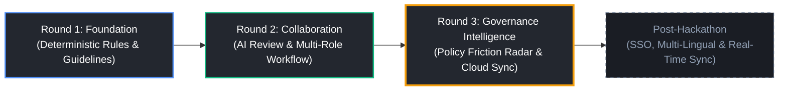

# BrandForge Product Roadmap & System Boundaries

**Codex 48 Round 3 — The Finish**  
**Repository:** [https://github.com/vishal-s-sollapure/Inkloom-AI-BrandForge](https://github.com/vishal-s-sollapure/Inkloom-AI-BrandForge)  
**Live Application:** [https://brandforge-inkloom.netlify.app/](https://brandforge-inkloom.netlify.app/)

---

## 1. Feature Maturity & Delivery Matrix

### ✅ Delivered in Round 1: Core Platform Foundation
- Deterministic regex & AST brand rules engine (avoided terms, promissory claims, hyperbole, sentence limits).
- Score deduction algorithm with severity weighting (High -18, Medium -8, Low -3, floor 10).
- Side-by-side visual diff comparison.
- Local brand guidelines configuration and JSON import/export.
- Client-side LocalStorage campaign history.

### ✅ Delivered in Round 2: Collaborative Multi-Role Workflow & Evidence Review
- Serverless Netlify Function wrapper for Google Gemini 1.5 Flash.
- Structured output schema enforcing guideline attribution, confidence scores, and factual claims extraction.
- Deterministic fallback engine guaranteeing zero downtime when AI is offline.
- Three distinct stakeholder roles (`creator`, `custodian`, `legal`) with strict state machine boundaries.
- In-line contextual review comments with resolution tracking.
- Cryptographic SHA-256 compliance seals binding finalized content and authorized sign-offs.

### ✅ Delivered in Round 3: Governance Intelligence, Hardened Cloud Sync & Complete Finish
- **Improvement 3: Governance Intelligence & Policy Friction Radar**:
  - 8-metric KPI ribbon (Total Audited Campaigns, Clean First-Pass Rate, Avg Turnaround, Active Friction Points, etc.).
  - Collaborative lifecycle pipeline tracking (`drafting` -> `in_review` -> `changes_requested` -> `brand_approved` -> `legally_cleared`).
  - Velocity & Bottleneck Radar diagnosing pending queue age and SLA breaches.
  - Recurring Violations & Brand Drift Radar tracking persistent breaches and direct campaign inspection.
  - Policy Friction Radar analyzing subjective adjectives, conflicting rules, and empirical reviewer disagreements.
  - Concrete measurable rule rewrite recommendations with one-click clipboard copying.
  - Exportable governance reports in Markdown and structured JSON.
- **Enterprise-Grade Supabase Cloud Sync**:
  - Real database CRUD across all 8 tables with strict Row Level Security (RLS).
  - Server-side anti-escalation triggers preventing unauthorized role elevation.
  - Status enum normalization preventing database write failures.
  - Visual badges distinguishing cloud-persisted records from local sandbox drafts.
  - Zero false-success UI notices — approval toasts appear only after verified database persistence.
- **Security & Privacy Hardening**:
  - Diagnostic endpoint sanitization (zero exposure of API key prefixes or lengths).
  - Public anonymous keys only on client; zero service-role keys.
  - Non-destructive intelligence engine preserving original guideline objects.
- **Automated Test Coverage**:
  - 85 automated tests across 5 test suites with 100% pass rate.

---

## 2. Operational System Boundaries & Edge-Case Handling

| Boundary / Edge Case | System Behavior & Mitigation |
| :--- | :--- |
| **Missing / Invalid Gemini API Key** | The serverless backend (`netlify/functions/review-brand.mjs`) automatically detects invalid or unconfigured keys and seamlessly delegates to the built-in deterministic fallback engine. Content review succeeds with full finding attributions and an informative advisory notice. |
| **Supabase Network Disconnection** | If Supabase cloud is unreachable or offline, BrandForge automatically falls back to the in-memory `LocalFallbackStore`, preserving user work without crashing or silently losing state. |
| **Role Escalation Attempt** | If a user attempts to modify their profile role via client-side request or metadata injection, PostgreSQL trigger `prevent_profile_escalation` immediately rejects the transaction with code `P0001`. |
| **Status Enum Mismatches** | All database writes pass through strict status normalizer functions, ensuring legacy terms like `"approved"` are converted to PostgreSQL enum values (`brand_approved`, `in_review`, `drafting`, `legally_cleared`, `changes_requested`). |
| **Large Text / Input Flood** | The AI review and deterministic engines enforce strict boundaries: titles capped at 120 characters, content validated against word count caps, and special regex characters safely escaped. |

---

## 3. Post-Hackathon Roadmap

### Phase 1: Enterprise Identity & Workspace Collaboration (Q1 2027)
- **SAML 2.0 / Okta / Azure AD SSO**: Enterprise identity provider integration for automated employee onboarding and role provisioning.
- **Real-Time Presence via Supabase Realtime**: Live collaborative co-editing, live cursor presence, and instant notification pushes when reviews are requested.
- **Multi-Tenant Workspace Switching**: Support for enterprise parent companies managing distinct child brands with segregated guideline databases.

### Phase 2: Design Tool Integrations (Q2 2027)
- **Figma Token Sync**: Direct bidirectional synchronization with Figma design systems to extract typography and brand voice parameters into BrandForge guidelines.
- **Canva MCP / Netlify Extension**: In-app pre-flight review modal embedded directly into Canva and CMS publishing pipelines (Contentful, WordPress).
- **Chrome Extension / Google Docs Add-on**: Real-time inline brand voice assistance for corporate communications and PR teams.

### Phase 3: Global Compliance & Localization (Q3 2027)
- **Multi-Lingual Brand Voice Analysis**: Gemini-powered tone and nuance evaluation across 25+ global languages and cultural contexts.
- **Automated Legal Disclosure Engine**: Context-aware legal disclosure suggestions based on jurisdiction (FTC in US, ASA in UK, GDPR in EU) and campaign category (finance, health, software).
- **Predictive Policy Simulation**: What-if policy impact modeling allowing brand directors to simulate how changing a rule will impact historical campaign compliance rates before publishing.

